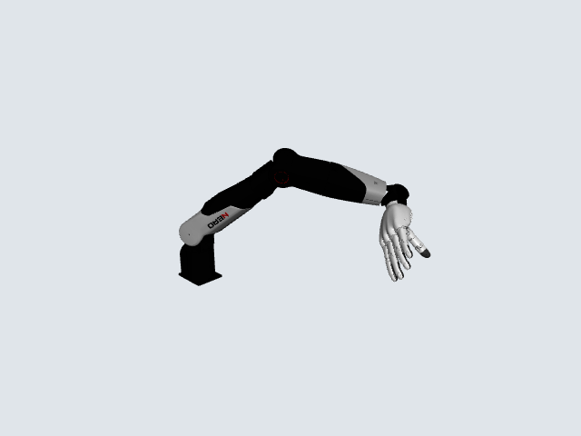

# NERO × DH116 — MuJoCo 仿真资产

松灵 NERO 七轴机械臂与 DH116-L000-A1 左手的组合机器人模型，用于 MuJoCo 场景搭建和 robosuite 工程接入。提供一套组合 MJCF、源 URDF、可视网格、分块凸碰撞代理及状态／动作契约。



## 模型规格

| 项目 | 内容 |
| --- | --- |
| 机械臂 | NERO，7 个旋转关节 |
| 灵巧手 | DH116 左手，11 个关节、6 个主动通道、5 组线性 Mimic |
| 动力学 | 刚体质量与惯性、关节限位、机械臂力矩驱动、手部位置伺服 |
| 碰撞几何 | 分块凸代理：机械臂 51 块、灵巧手 76 块、连接件 8 块 |
| 状态／动作 | 18D 关节位置；7D 机械臂绝对关节目标＋6D 独立手位置目标 |
| 参考运行环境 | Python 3.11、MuJoCo 3.2.3；动态接入采用 robosuite 1.4.1 |

## 安装与预览

在 Linux 下创建 Python 3.11 环境，并从仓库根目录运行：

```bash
git clone https://github.com/LeoandDream/Nero_DH116_assets.git
cd Nero_DH116_assets
python3.11 -m venv .venv
source .venv/bin/activate
python -m pip install -r requirements.txt
python examples/view_static.py
```

叠加碰撞代理、显示挂载座，或在支持 EGL 的环境中导出图片：

```bash
python examples/view_static.py --collision
python examples/view_static.py --collision --mount
MUJOCO_GL=egl python examples/view_static.py --image preview.png
```

查看器显示模型的参考姿态，不推进仿真时间。`--mount` 只控制挂载座的显示，碰撞和惯性设置保持不变。

## 在自己的程序中加载

以下代码从仓库根目录加载机器人，并按契约读取关节位置：

```python
import json
from pathlib import Path

import mujoco
import numpy as np

root = Path.cwd()
model = mujoco.MjModel.from_xml_path(str(root / "mjcf/nero_dh116.xml"))
data = mujoco.MjData(model)
mujoco.mj_resetDataKeyframe(model, data, 0)
mujoco.mj_forward(model, data)

contract = json.loads((root / "docs/robot-contract.json").read_text())
joint_ids = np.array([
    mujoco.mj_name2id(model, mujoco.mjtObj.mjOBJ_JOINT, name)
    for name in contract["state_order"]
])
if np.any(joint_ids < 0):
    raise ValueError("模型缺少接口契约中的机器人关节")
state = data.qpos[model.jnt_qposadr[joint_ids]].copy()
print("机器人状态维度:", state.shape)  # (18,)
```

组合机器人入口是 `mjcf/nero_dh116.xml`。`urdf/` 提供机械臂、左手及机械臂带法兰的独立描述，没有完整 NERO＋DH116 组合 URDF。复制 MJCF 时需同时保留其相对路径引用的 `meshes/`。

## 接入控制

| 接口 | 前 7 维 | 后 6 维 |
| --- | --- | --- |
| Robot action | 机械臂绝对关节目标角，rad | 独立归一化手位置目标，[-1, 1] |
| MuJoCo `data.ctrl` | 机械臂电机力矩，N·m | 主动手关节目标角，rad |

机械臂位置目标需经关节位置控制器转换为力矩，手部目标需映射到各主动关节角度范围。参考集成使用 robosuite `JointPositionController.set_goal(..., set_qpos=...)` 的绝对位置入口和 MuJoCo position 伺服；**Robot action 不能直接赋给 `data.ctrl`**。本仓库提供模型文件、接口定义及[原生 LIBERO 白碗参考入口](examples/libero_reference/README.md)；其他任务环境由下游工程配置。

机器人采用固定基座，默认世界位置为 `(-0.569, 0, 0.912) m`。接入新场景前需核对基座位姿、挂载座、相机和模型级求解设置。详见[模型与接入说明](docs/MODEL.md)。

## 独立动态参考测试

无需访问历史实验目录，按[安装与运行说明](examples/libero_reference/README.md)重建固定环境后：

```bash
source examples/libero_reference/env/activate.sh
python examples/libero_reference/run.py --output runs/white_bowl
```

参考入口直接使用本仓库 MJCF 与 Mesh，执行230条命令及5750个真实物理步，并输出逐步差异报告。原生任务与严格抓取成功信号保持原定义，参考结果均为 false。

## 仿真演示与验证

[白碗闭合、抬升与持握演示][demo]

在参考 LIBERO 场景中，模型完成白碗闭合、抬升和连续 1.5 s 对向持握。测试采用 230 个 13D 命令、5750 个物理步；Mimic 峰值偏差约 0.001 rad，最大手—碗代理交叠约 0.580 mm。测试条件、结果和适用范围见[验证说明](docs/VALIDATION.md)。

## 文件检查与许可

```bash
sha256sum -c SHA256SUMS
python -m unittest discover -s tests -v
```

第一条命令核对交付文件完整性；第二条检查查看器的显示过滤及所覆盖物理字段不变性。网格来源和源描述映射见 [SOURCE_MANIFEST.json](SOURCE_MANIFEST.json)、[URDF_SOURCES.json](URDF_SOURCES.json)。

资源按来源分别提供许可：NERO URDF 为 MIT，DH116 为 Apache-2.0；厂家连接件的独立许可尚未确认。详见[来源与许可](licenses/SOURCES.md)。

[demo]: examples/libero_reference/evidence/closure-side.mp4
