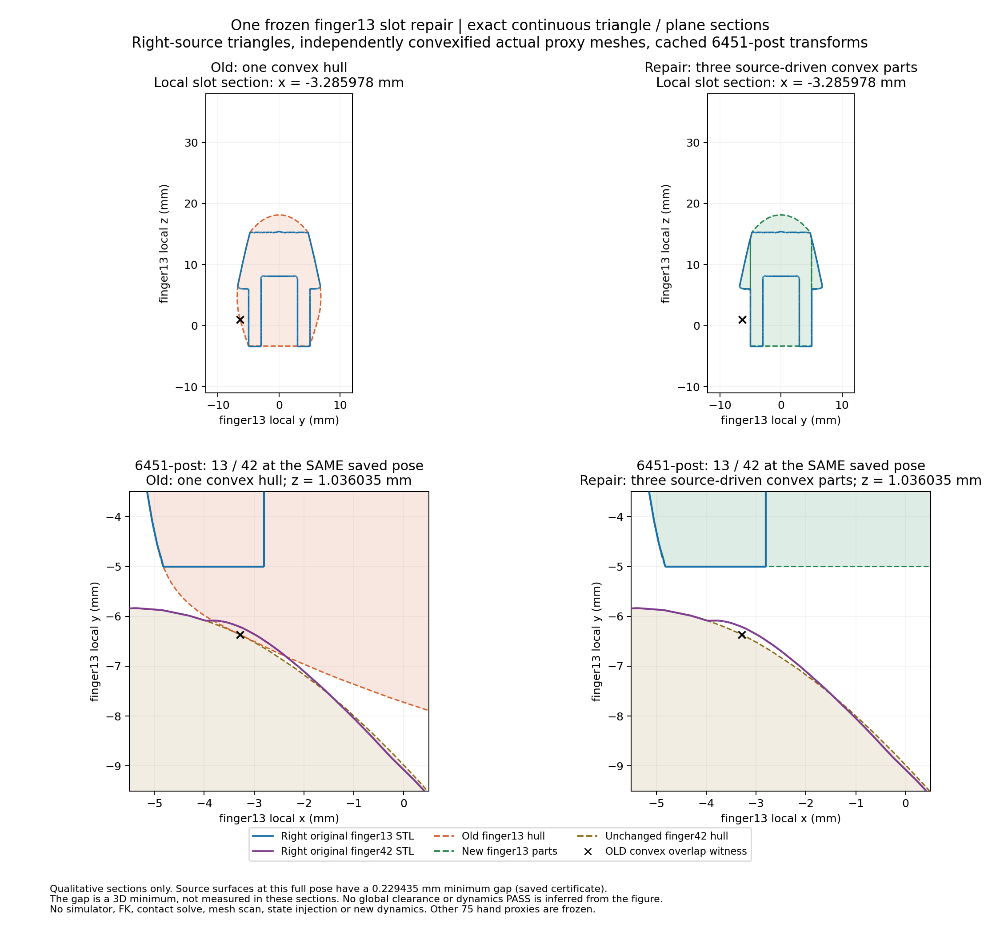

# D3：finger13 跨槽封口的一次局部静态修复

**局部目标PASS：6451的额外凸包相交已消除，右手finger13源面未丢失。整只右手高保真仍UNKNOWN；动力学NOT_RUN。**
仅一个设计、一个候选，没有参数扫描、重试另一方案或修改finger42。
任务：[PR #4评论6259139848](https://github.com/LeoandDream/Nero_DH116_assets/pull/4#issuecomment-6259139848)。

## 改动与不变性

基线 `c61f97777c42ea421d0460252abc7dbeb48b282b`，原76块候选SHA256 `56949ed130a54b1d8b5fbd76e51b1262b45b7346e29130e42e8db156dd7d15d6`。
独立分支 `feature/d3-right-finger13-local`。新候选 [`../../candidates/finger13_local/model.xml`](../../candidates/finger13_local/model.xml)，
SHA256 `b27f4f86fbaeacd2bb925463f39f67181ef7db12963c4d9f7fc01797a7924d1b`。

用右手自身 `meshes/dh116_right/source/finger13_link.STL`（SHA256 `594501a21c86d1d19b73cf17572b7a04ae488c5fee4b623e25c618dd15eb3419`）
按原生CAD平面Y=±4.999999888241291mm分为中部和两侧翼，每个原三角逐面精确裁剪、全部保留后各自凸化。
纯共面铰接耳面只分给中部，避免再次将低部耳与上部侧翼连成错误凸包；没有裁掉真实指面、整体缩小或形变。

| 新件 | 裁剪源三角数 | 凸顶点数 | OBJ SHA256前12位 |
| --- | ---: | ---: | --- |
| negative_wing | 3767 | 845 | a4621dd53571 |
| central | 6159 | 738 | 8c20a825d742 |
| positive_wing | 3656 | 805 | 6831b4df4dbd |

全部源三角索引、精确切平面、完整SHA及75块冻结映射在候选 `manifest.json`。
75块原代理的名称、geom属性、mesh绑定与文件字节逐一不变；旧finger13碰撞geom一换三，旧asset保留但无碰撞引用。
现在手部78块、臂51、法兰8，共137个分块代理；未叠加旧13碰撞。全部548个原tracked文件、旧76候选、左手V1、正式右手及历史FAIL证据保持不变。
规范化XML除授权13几何外精确一致；3762项编译物理字段一致，控制、Mimic、质量惯性、装配、mask/exclude及Keyframe均未变。
见 `independent_scope_review.json`、`final-mechanics-audit.json`、`verification.json`。

## 同姿态分离证据

| 已存姿态 | 右源STL最小表面间隙(mm) | 旧76凸代理 | 新三件凸代理最小表面间隙(mm) |
| --- | ---: | --- | ---: |
| 6451-pre | 0.175174198 | 严格相交 | 0.177093674 |
| 6451-post | 0.229434545 | 严格相交 | 0.242226134 |

代理间隙来自每个真实碰撞件凸化后的**连续三角面完整BVH搜索**，每对均无相交；源间隙由精确qpos、源SHA及FK重新匹配原证书。
另有逐块凸半空间LP：post三个原始最大公共球半径分别−0.480115284、−0.104591573、−5.212352748mm，
在1e−7／1e−8／1e−9三组LP数值可行性容差及保守数值平面扩张下均分离，60位Decimal原／对偶证书一致。
**LP半径不是物理间隙或穿透深度**；正负证据与连续曲面结果相互核对。

MuJoCo `mj_geomDistance` 在0.1／1m大cutoff下仍给已分离块返回负数；0.01m的正值也不等于精确间隙。
这些原始异常完整保留，不能单凭某个cutoff宣布PASS。此处PASS仅指独立证明的静态几何局部目标，尚未证明实际接触求解行为。
证据：`contacts/summary.json`、`contacts/contacts.json.gz`（完整原始数据，解压SHA见 `archive.json`）、
`contacts/convex-surface-gaps-portable.json`。



## 覆盖、误差与残留问题

全部13020个RIGHT源三角面连续覆盖：12737面由同凸片包含证明，283面由跨片连续裁剪核对，未覆盖面积0，新增丢失旧覆盖面积0。
沿用既有1e−10m数值平面容差；builder逐源面裁剪的最大面积差2.012e−21m²，未增设物理验收阈值。
旧LEFT来源单凸包的RIGHT源面未覆盖比例为4.647690%，新候选为0%。覆盖不等于代理边界与源面处处重合。

相同4096双向面积样本、seed763、连续目标三角面及暴露并集边界；下表为**p95／p99／观测max，单位mm**，不是Hausdorff上界：

| 方向 | 旧单凸 | 新三片 |
| --- | --- | --- |
| 源面→代理并集 | 5.505347/7.812079/8.443434 | 4.002150/6.864009/7.925626 |
| 代理并集→源面 | 2.210287/3.014003/3.672276 | 0.990842/2.465864/2.981445 |

原槽区域Y∈[−6.5,−5]mm的双向p99：源→代理4.348258→1.137386mm，代理→源1.490043→1.008805mm。
必须保留的限制：

- 新三片并非旧LEFT凸包子集：负翼／中部／正翼最大半空间超出旧包分别0.189915／0.015265／0.025277mm，来自RIGHT原面覆盖恢复；均在RIGHT源全局凸包内。
  不能据“只缩小旧凸包”证明所有姿态均不会新增碰撞。
- 14个旧pre/post姿态×其他16个手link，未新增被测eligible负查询body pair；未验证所有运动路径或其他外物接触。
  6242的13↔42源面真实穿面及代理交叠仍在；6395的原源面风险和其余未改pair保留，不能因本次修复改判原7000步FAIL。
- 中央叉槽仍有凸包封口。暴露并集全部顶点→源面最大值0.274883→0.527754mm；法向锐角p95源→代理84.301→90°、反向70.513→76.568°。
  法向最近面在边缘可能不唯一、源STL整体方向未认证；这些反例不被省略，也不新增门槛掩盖。不能声称全部几何指标改善或整手高精度PASS。

完整最大值坐标、最近三角面、覆盖面片、法向与包含性见 `quality/{old,new,summary}.json`。
本轮仅静态FK及距离／几何查询：**新物理步、reset、forward、collision、约束求解均0**。
控制健康、抓持、整手动态与全7000步结论均未重新验收，旧全幅及白碗FAIL保留。

**唯一下一步：先复审并冻结本局部候选，再决定是否授权后续限定工况验证。** 本轮停止，不继续精化42或其他link、不合并main。

## 可复核命令

本轮未安装依赖，使用既有锁定环境（实际解释器及版本见 `environment.json`）。
第三方先按 `examples/libero_reference/env/README.md` 建立checkout内环境，再激活；当前worktree没有新建 `.reference-env`。
以下全部是静态命令，输出使用新路径：

```bash
source examples/libero_reference/env/activate.sh
mkdir -p runs
python tools/build_finger13_local.py --output runs/finger13_rebuild
python examples/right_hand/finger13_audit.py   --candidate examples/right_hand/candidates/finger13_local/model.xml --output runs/f13_audit.json
python examples/right_hand/finger13_quality.py   --candidate examples/right_hand/candidates/finger13_local/model.xml --output runs/f13_quality
python examples/right_hand/finger13_contacts.py   --candidate examples/right_hand/candidates/finger13_local/model.xml --output runs/f13_contacts
python examples/right_hand/evidence/d3_finger13/convex_surface_check.py   --candidate examples/right_hand/candidates/finger13_local/model.xml   --contacts examples/right_hand/evidence/d3_finger13/contacts/contacts.json.gz --output runs/f13_surface.json
python examples/right_hand/evidence/d3_finger13/visual/plot_comparison.py --output runs/f13_visual
sha256sum -c examples/right_hand/evidence/d3_finger13/SHA256SUMS
```

复用原mesh读取、三角面裁剪/BVH、凸并集边界及静态API保护，没有新动力学算法或通用测试框架。
分离／相交／相切三例，以及连续覆盖等四例的工具自检，见本目录 `*_checks.json`、`contact_validation_selfcheck_final.json`；不是新增CI或物理门槛。
