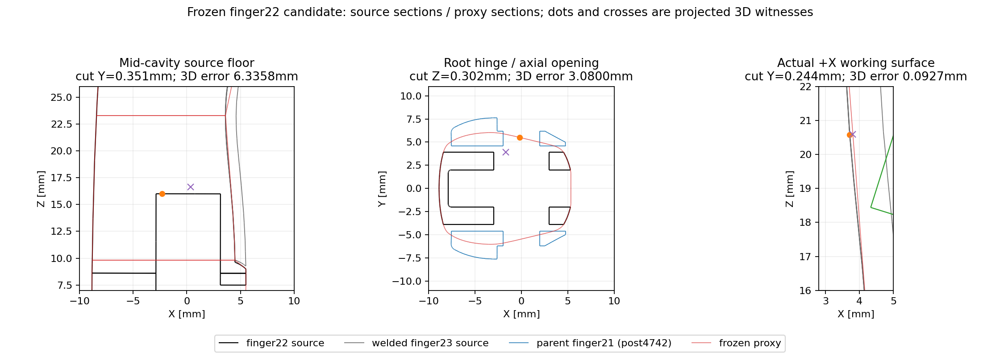

# f641348 风险归因：建议 A，仅申请探索性白碗动力学

任务：[PR #4 / 6272512082](https://github.com/LeoandDream/Nero_DH116_assets/pull/4#issuecomment-6272512082)。冻结 `f641348` 的81块手部、306块腕部；模型SHA256仍为 `7f9d84061c3e7d176763c688d2389f8b3d3e38386b8e990a0fa047ff2bc3329c`。**原数值验收FAIL不变；本轮零代理构造、零动力学、零742姿态碰撞重扫。**



| 既有见证（finger22局部坐标，mm） | 定位与功能 | 对限定工况的实际证据 |
|---|---|---|
| **6.335794mm** 埋面，`(-2.293466, 0.351057, 16.003267)`，源面 **8902**，片 **01** | 中段内凹底面；这是源面到并集外边界的距离。材料/空腔连通性仍UNKNOWN，不能按6.34mm外接触面外扩解释。 | 80个原RK4缓存中，完整源见证三角面对完整36碗box的分离下界最小 **1.024967mm**；对应完整compiled支撑三角面最小 **1.735143mm**。另保留raw三角面的2.954030mm结果，未用它代替compiled。 |
| **3.079960mm** 反向偏差，`(-0.196022, 5.504977, 0.302027)`，最近源面 **10155**，片 **00** | 根部Y向铰孔/侧开口；10155三顶点距关节Y轴约3mm。旧单凸与新根片均封填轴孔探针，属于继承的近似。 | 根片完整compiled几何对完整白碗在80缓存中的分离下界最小 **1.434936mm**；另核对5个post-FK姿态。finger21是原父子过滤，finger23是原焊接固定体，二者与finger22不合资格内部碰撞；没有新增exclude。真实铰孔材料和全幅运动间隙仍UNKNOWN。 |
| **0.092698mm** 工作面偏差，源面 **6165**，片 **01**：源点`(3.713981,0.243761,20.580657)` → compiled点`(3.806385,0.245952,20.587701)` | finger22自身+X前面；整指前方还有固定finger23覆盖件，不推断其材质。 | 既有1024样本沿4742已记录朝碗方向均先遇finger23源面，最近前置 **0.915137mm**。源工作区及10µm分析边界的YZ矩形经连续三角投影扣除，+X覆盖未覆盖面积 **0**；所用源面均在整块下凹腰片最前X之前方至少 **0.028801mm**。斜向射线为有限证据，+X连续证明不扩展到任意方向。 |

复用旧742结果：全部合资格对子原158严格交叠→0，926个非目标手—碗接触对子状态/距离不变。只读取旧证书取得最小下界，**没有重新进行742姿态FK/碰撞扫描**。本次新增FK仅4001、4518、4641、4664、4742这5个保存post姿态；4518不具备finger22 RK4缓存。80个RK4缓存的几何界限直接使用原body变换，不积分。

raw反向3.079960mm与compiled反向3.025393mm来自不同三角化上的有限样本。把原raw极值点直接投到compiled边界仅移动0.021826nm，其到源面的距离仍为3.079960mm；两组采样极值之差不是约0.055mm编译位移。

数值来源已独立解释。[MuJoCo 3.2.3 `user_mesh.cc`](https://github.com/google-deepmind/mujoco/blob/3.2.3/src/user/user_mesh.cc#L917) 中OBJ顶点为float；减质心和主轴旋转后均写回float。对全部 **3431** 个OBJ顶点，`a=fl32(p); b=fl32(a-c); z=fl32(Rᵀb)` 与实际`mesh_vert`逐位一致。质心/旋转取实际编译值，重建使用同一组值，其估计偏差不作为额外物理位移累计。

逐片理论输入尺度上界（00→03）为 **1.839139 / 1.873528 / 2.907642 / 3.032173nm**，基于各阶段half-ULP、矩阵范数、正交残差及显式float64传播项；不依据已测最大值倒推容差。假设与全部量见`numeric.json`。最大0.967846nm平面偏差分解为 **0.599952 + 0.128414 + 0.239481nm**（读入、减重心、旋转写回），double余项可忽略。该结果解释3602面形成纳米薄层数值覆盖FAIL，**不是验收豁免，也不是新标准**；原`1e-10m`及所有历史FAIL原样保留。

**唯一建议 A：保留当前FAIL，申请一次沿原冻结动作/Reset/控制/过滤与停止规则的探索性白碗动力学，需另行批准，本轮不执行。** 已保存白碗工况中，大偏差位于内凹/根部装配区，关键前表面有固定覆盖件及净空证据，当前没有证据要求先修改功能接触面。这个判断只用于限定纯仿真诊断；不将非流形材料UNKNOWN、全幅闭合、未运行的后续姿态、lift/hold或真实抓持评为PASS。原7000步FAIL、正式左右手、共享资源、main和用户README均不动。

证据：`witnesses.json`、`context.json.gz`、`numeric.json`、`working-cover.json.gz`、`api-audit.json`、`provenance.json`、`SHA256SUMS`。截面为真实源三角/冻结代理切面，橙点与紫叉为3D见证的投影；所标误差是3D距离，不能按投影线段量取。

复核（MuJoCo3.2.3及已有NumPy/SciPy/Matplotlib环境，无需LIBERO运行器）：

```bash
env OPENBLAS_NUM_THREADS=1 OMP_NUM_THREADS=1 MKL_NUM_THREADS=1 \
  /data_robot/verification/nero_dh116_right/.reference-env/bin/python -B \
  examples/right_hand/evidence/d3_finger22_risk_review/review.py --output /tmp/finger22-risk-new
sha256sum -c examples/right_hand/evidence/d3_finger22_risk_review/SHA256SUMS
```
