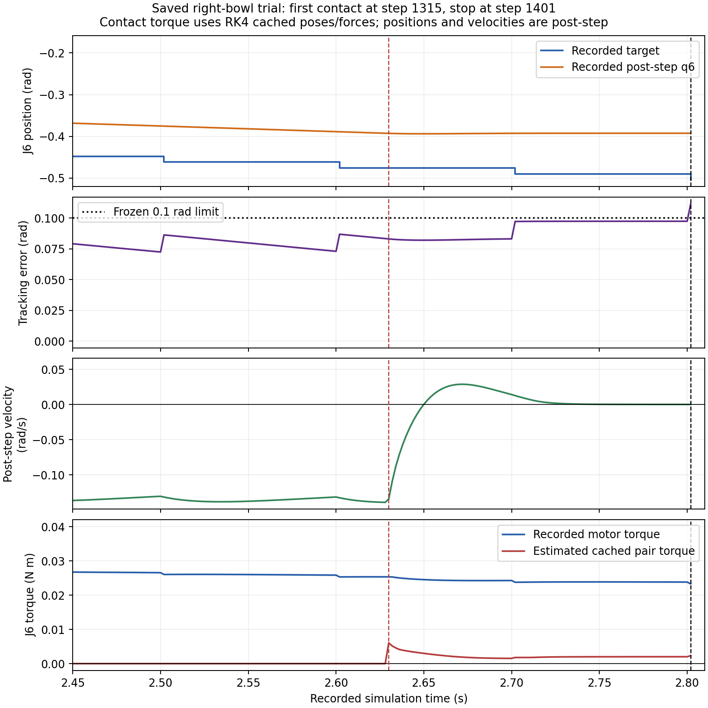

# link5—法兰与J6：保存轨迹的只读诊断

**做了什么：**以 `84db1dcb3206dcf4013d17a55635d7eef572a25c` 保存的1401步为唯一右手输入，核查六个姿态的完整源三角面、实际编译代理及接触力矩，并绑定左手D2已有记录。没有运行新动力学，也没有改模型、控制、动作、过滤或阈值。

**发现什么：**五个接触缓存姿态的源面均分离，实际代理却严格相交，支持“**相对所提供源表面的代理假接触**”。接触对J6的净广义力矩估计为正，阻碍目标要求的q6减小，不能因法向力小就忽略。接触前已有跟踪滞后，接触后速度快速下降并转正，1401步的新目标阶跃最终触发0.1rad界限；**唯一根因仍UNKNOWN**。

**解决／排除了什么：**将“源面真的交叉”与“凸代理填空”分开，并计算了内部作用—反作用的净J6贡献，未重复叠加两体受力。没有证据把该局部接触当作源面穿透；也不能据此证明真实硬件无干涉、或证明只修代理便能完成抓持。

**唯一优先建议：**另建一个仅处理 `link5_4 ↔ flange_part_2` 局部凸化填空的几何候选，以所提供源面为依据保留真实表面覆盖、恢复局部间隙；保留其余代理、路径、JPC、过滤及已验收左手。现有证据不能唯一指认只是哪一块代理有问题，本轮不实施修复或追加运行。

## 六个关键状态

源间隙为完整厂家URDF碰撞STL的连续三角面BVH距离；OBJ视觉源面复核相同结论。1314没有保存该接触的缓存姿态，使用其post-qpos的静态FK；其余五点直接使用当时保存的RK4缓存body姿态。二者没有混称同一时刻。

| step | 源STL间隙 mm | 保存代理dist mm | q6目标 / 实际 rad | q6速度 rad/s | 电机力矩 N·m | 估计接触τ6 N·m |
| ---: | ---: | ---: | --- | ---: | ---: | ---: |
| 1314 | 3.273350 | 无该接触；post-FK代理分离 | −0.475843 / −0.392485 | −0.138915 | +0.0253722 | 0，接触对未记录 |
| 1315 | 3.273764 | −0.001707 | −0.475843 / −0.392763 | −0.134197 | +0.0253701 | +0.00606132 |
| 1321 | 3.275188 | −0.019980 | −0.475843 / −0.393664 | −0.032700 | +0.0247872 | +0.00356710 |
| 1326 | 3.275910 | −0.022838 | −0.475843 / −0.393776 | +0.006184 | +0.0245084 | +0.00286851 |
| 1400 | 3.280475 | −0.004027 | −0.489963 / −0.392493 | +0.000194 | +0.0238417 | +0.00201854 |
| 1401 | 3.280477 | −0.004022 | −0.504083 / −0.392493 | +0.000177 | +0.0233272 | +0.00231567 |



源DAE→交付OBJ的全三角覆盖偏差上界：link5约7.62nm、法兰4.36nm；源STL→OBJ上界约0.147µm/8.54nm，均远小于3.27mm源面间隙。实际代理使用编译后的 `mesh_graph` 三角面，不以重新凸化的网格或 `mj_geomDistance` 负值代替；五个缓存姿态均有严格面交叉及内部球证书。保存接触点离两份源表面分别约4.14mm/4.96mm，表明两侧代理局部均可能填空，不能只凭此选定单块责任。

**几何限制：**link5源OBJ/STL不是闭合流形，winding仅作诊断，实体包含及真实硬件穿透为UNKNOWN。正源面距离只适用于这些离散姿态；代理内部球半径不是物理穿透深度，也不是新验收阈值。

## J6受力与失效边界

采用内部接触的虚功投影：`τ6=(Jp_flange−Jp_link5)ᵀF+(Jω_flange−Jω_link5)ᵀM`。link5位于J6上游，其J6列为零；由缓存link5姿态及link6固定装配变换得到同一缓存时刻的轴/支点。`F=frameᵀ·force[:3]`对geom2/法兰取正号，与 [MuJoCo 3.2.3接触Jacobian约定](https://mujoco.readthedocs.io/en/3.2.3/computation/index.html#contact)及[源码的Jacobian差与接触坐标投影](https://github.com/google-deepmind/mujoco/blob/3.2.3/src/engine/engine_core_constraint.c#L977-L1048)相符；具体原始源码行号和SHA见`torque-sources.json`。

- 87个接触步的净估计均为正：**+0.001538～+0.006061N·m**，约为记录电机输出的**6.33%～23.89%**。法向分量为+0.002305～+0.008278N·m，85/87步切向贡献部分抵消；接触点到J6轴约22.82mm。
- 接触前误差已明显累积：1314为0.083358rad，接触前最大0.086912rad（1301）。1325起q6速度转正。1400→1401目标下降0.014119824rad，而实际增加3.71065e−7rad，误差0.097469992→0.111590187rad。这是跨阈值的算术分解，不是无接触反事实。
- 其余六个臂关节的全轨迹最大误差分别为0.022838、0.023982、0.003180、0.047579、0.042364、0.012835rad；记录中未触±100Nm控制限幅，不能先认定整个JPC失效。
- 力矩方向和量级足以构成不可忽略的控制影响假设；**显著影响程度及唯一因果仍UNKNOWN**。缺少保存的`qfrc_constraint/qfrc_bias/qacc/质量矩阵`，电机总输出比值不等于去除重力补偿后的伺服净力矩比值。估计不是实际`qfrc_constraint`，也不是完整求解器重建。
- 接触力/姿态属于RK4最后内部stage，记录qpos/qvel为积分后状态，ctrl由前一控制状态计算。力矩估计本身使用缓存姿态；与状态、速度、电机输出的对照仍有时间对齐限制。独立静态Rodrigues有限差分与解析投影误差≤1.25e−12N·m，无积分或约束求解。

## 左手参照与证据

左D2原始scene/trace/contact与已交付记录逐字节绑定。左右机械臂／法兰／挂载座的14个body局部定义、51+8块代理及相关69个mesh字节/参数、7个motor、kp/kd和初始arm7一致；手负载不同（声明质量左0.24564069kg、右0.23767046kg）。左5750步没有这组接触，J6最大误差0.078150rad，但最近已有左姿态距六个右姿态仍约0.145rad（7关节未加权L2，仅描述距离，无新增阈值）；J7轨迹也不同。**没有同姿态／同控制对照，不能用左手该轨迹未记录此接触来否定右手的代理问题。** 左D2通过指固定诊断精确复现，native/strict信号仍为false。

`geometry-summary.json`与`geometry-results.json.gz`保存源面距离、实际凸包面、最近点和LP证书；`source-provenance.json`绑定URDF/DAE/STL/OBJ；`torque.json`、两份压缩逐步表及源码摘录保存力矩计算；`left-reference.json.gz`绑定左手参照。四份离线分析脚本及一份画图脚本仅服务本次记录，没有进入运行器；全部文件由`SHA256SUMS`绑定。`verification.json`核对所有输入、raw SHA和保护范围。

复查入口：

```bash
# 本机复用的锁定解释器；NEW输出须不存在。均不执行动力学。
REF_PY=/data_robot/verification/nero_dh116_right/.reference-env/bin/python
"$REF_PY" examples/right_hand/evidence/d3_link5_flange/geometry.py --output runs/NEW_geometry.json
"$REF_PY" examples/right_hand/evidence/d3_link5_flange/torque.py --output-dir runs/NEW_torque
"$REF_PY" examples/right_hand/evidence/d3_link5_flange/left_reference.py \
  --left-run /data_robot/verification/nero_dh116_d1b/runs/d2/reference_001 \
  --output runs/NEW_left.json
```

左侧原始scene路径是显式的本机审计输入，不是右手运行依赖；其SHA和绑定结果均已归档。最终编译凸包分析调用FK6次；计入初步只读凸包检查，本轮静态FK共12次，名称查询15次。其余分析不导入仿真器；全轮新增物理步、forward、碰撞生成、Reset、约束求解均0。原1401步FAIL、抓持UNKNOWN及原7000步FAIL不变；没有合并main或修改任何既有资产、轨迹、控制、碰撞规则和README。
