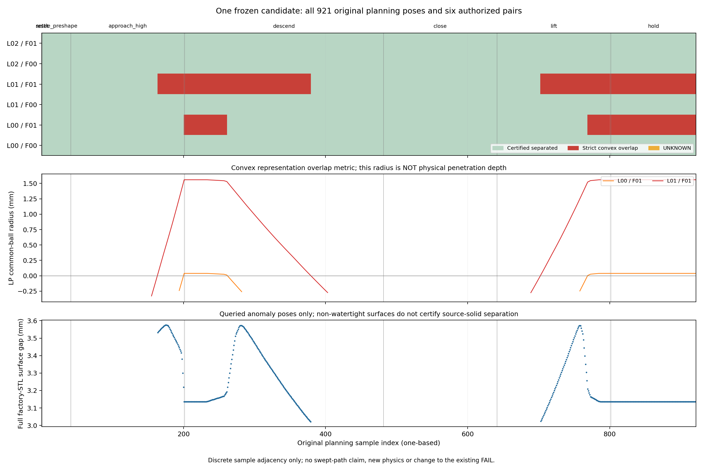

# D3 全路径静态诊断：调查完成，候选仍 FAIL

依据[任务评论6265318780](https://github.com/LeoandDream/Nero_DH116_assets/pull/4#issuecomment-6265318780)，固定 `dcd6540d9103df83dc24c1eff3cb98f80ab619db`、现有5块局部代理和原921个白碗规划姿态，完成全部 **5526** 对检查；没有首失败停止，没有生成候选或运行动力学。旧冻结验收入口及所有旧FAIL不变。

## 全部异常与分布

**4877对已证分离，649对严格凸重叠，0对UNKNOWN；涉及435/921个姿态。** 这435姿态全部核查厂家完整STL，源三角面间隙 **3.020345825–3.575464064 mm**，未发现源面相交，因此649次均为源表面意义下的凸代理假接触。源link5非水密，实体包含/硬件干涉仍UNKNOWN。

| 局部代理 pair | 严格重叠姿态数 | 连续采样索引区间（从1起） | 最大LP内球半径 mm |
| --- | ---: | --- | ---: |
| link5_01 ↔ flange_01 | 435 | 164–379；703–921 | 1.559028226 |
| link5_00 ↔ flange_01 | 214 | 201–261；769–921 | 0.039366769 |
| 其余4对 | 0 | 无 | — |

214个00/01姿态同时也有01/01重叠，因此不能把649次pair事件写成649个异常姿态。按阶段：approach_high **38/160**、descend **178/280**、lift **99/160**、hold **120/120**；reset、settle_preshape、close均无本局部pair异常。进一步分为7个阶段/pair同质簇，见[分布数据](distribution.json)。连续只指采样索引相邻，不证明未采样运动的连续碰撞状态。

- 最早：#164 `m040_quarter3`，复现旧LP半径0.031772091 mm、源面间隙3.532862888 mm。
- 最大凸重叠指标：#220 `m054_quarter3`，两pair各自达到上表最大值；源面间隙3.136053501 mm。LP半径不是物理穿透深度。
- 最晚：#921 `m229_quarter4`，两pair仍重叠；持握规划段未摆脱该问题。
- 几何位置：LP球心位于link5局部坐标同一弯折凹口邻域；00/01的包围范围约 `x=8.878…8.924,y=-23.071…-23.064,z=-23.935…-23.890 mm`，01/01约 `x=10.052…12.054,y=-21.576…-20.590,z=-25.398…-21.944 mm`。这是凸重叠见证的位置，不是物理接触点或源面最近点。



## 封口归因与唯一下一步

首失败的实际编译面 `link5_01 face54 ↔ flange_01 face45` 均由真实源点围成，但中间三角面跨过真实凹口；支架面54是长轴向斜封口，并非原y分区切面。支持点/源面ID、连续截面、源顶点半空间检查见[首失败归因](caps/first-failure-cap-attribution.json)。首失败两项单侧源面反事实间隙分别为4.708862392 / 1.318035204 mm，源顶点均不在对侧凸体内，不能归因成一侧唯一错误。

完整分布后的关键反证：在#220及#921，`link5_01 face53` 严格横穿 **flange_01所覆盖的真实源STL face505**，且8个该组件源顶点严格位于支架凸体内部，最深半空间残差约 **-0.822896 mm**。所以**只细分法兰、保持中段支架不变，不可能同时保源面又消除此重叠**。仅修中段支架也会留下214次00/01异常。四个首/最大/末代表姿态的混合几何与包含检查见[反事实证据](caps/representative-pose-counterfactuals.json)，不能外推成全435姿态的混合几何证明。

**唯一建议：下一版只对 `link5_local_01` 与 `flange_local_01` 联合作源凹口驱动的局部分区；冻结另外3块。** 支架分区须分开源面2963/3957与头部3330的支撑组；法兰须分开负z端64/4050与正z端4485的支撑组，沿凹口源面3770/4623及三角面邻接关系定义连续patch，保留过渡面，兼顾两类异常。只按 `z=-41.2908196 mm` 肩平面二分不足以分开关键支持弦，不推荐该方案。具体最少块数/全部patch边界尚未证明，不按单帧交叉点拟合、不承诺会通过；见[唯一设计约束](caps/next-design-proposal.json)。本轮不实施。未来候选须重新完成全部921×6及独立编译网格质量复核，保持现有阈值；任一未通过均不得进入动力学。

## 纳米残差单独结论

既有float64完整源覆盖仍成立（逐面数组36200/13302面未覆盖面积均0）。五个最大compiled包含违例点均为厂家源/旧OBJ的同一边界点，raw平面残差≤6.94e-18 m；其 **6.878/1.263/2.837/0.832/3.055 nm** 编译残差由重心平移、旋转的两次float32写回复现。7个局部网格5829顶点逐元素等于实际`mesh_vert`，5个见证点也逐元素复现；见[数值复核](numerics/roundtrip.json)及[逐面数组核对](numerics/coverage_array_audit.json)。这证明所查见证的数值来源，未证明每个未覆盖片段都同源。

相比之下，本路径最小严格LP半径已为 **4.204 μm**，最大1.559 mm；不能用3–7 nm量化误差解释这些凸填空。既有 `1e-10 m` 严格覆盖/包含验收继续 **FAIL**，不放宽、不改名绕过，也不把面覆盖面积误解为等比例实体材料缺失。

## 证据与复核

[扫描汇总](scan/summary.json)、[完整921姿态/5526对](scan/poses.json.gz)、[485份独立LP证书](scan/certificates.jsonl.gz)、[冻结输入/实际编译凸图](scan/frozen.json)及[24对代表横穿证书](representatives.json.gz)齐备。435个异常姿态绑定310次完整STL查询；只对R/t字节完全相同的姿态复用，未四舍五入合并。共有588种精确相对变换、333次复用。24对代表覆盖每同质簇/每pair连续段的首/最大/末，全部严格横穿。

锁定环境Python3.11.16、MuJoCo3.2.3、NumPy1.26.4、SciPy1.15.3。只读扫描约192秒，921次静态FK；**零mj_step、零forward/碰撞生成/物理约束求解**。输入SHA及全部原文件保护见[verification.json](verification.json)，3项针对性测试通过。候选MJCF SHA256仍为 `1b2530d923b446605492b43652dd5a3200fd755674ba17a54f0c961cde362b39`，规划SHA256仍为 `ba767b42f99d3562255909bde5c970d529ba254769029ec1cd7a98faf76af0fb`。

仓库根目录使用已有环境复核，不安装依赖；输出目录必须不存在：

```bash
python -m unittest discover -s tests -p test_link5_flange_fullscan.py -v
python examples/right_hand/link5_flange_fullscan.py --output runs/link5-flange-fullscan-review
sha256sum -c examples/right_hand/evidence/d3_link5_flange_fullscan/SHA256SUMS
```

退出码0仅表示调查完成，候选验收仍FAIL。静态离散采样不证明动态控制或抓持；原1401步控制FAIL、7000步全幅FAIL、抓持UNKNOWN以及native/strict=false均保留。正式左右手、共享网格、main和用户README未改，PR保持Draft。
