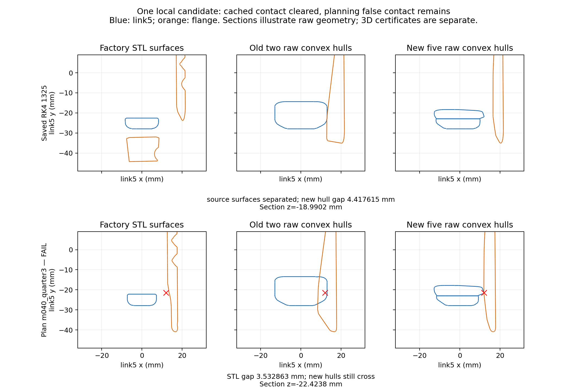

# D3 link5—法兰局部静态候选：FAIL，已停止

按[批准任务](https://github.com/LeoandDream/Nero_DH116_assets/pull/4#issuecomment-6263431193)，基于 `849f10a51ece64e5de2236f6b6d7c7f11f783ff8` 只构造一个独立候选。原87个接触缓存姿态中的假接触已消除，但既有白碗规划路径仍有代理假相交；本候选不能进入动力学。

## 做了什么

分别追溯两个旧代理，而非预设一块有错：`link5_4` 的1275个输入点对应厂家STL中一个2570面的弯折支架；`flange_part_2` 的3244点来自两个独立源组件，原分配6448面。旧凸包分别跨过支架凹口、法兰组件间的空隙。

冻结的唯一构造将支架按源CAD的两个y平面 `-0.02290000021457672 / -0.015800001099705696 m` 分为3块，将法兰的两个原组件分别凸化为2块。复用现有裁剪、凸化、OBJ导出和连续几何工具，没有缩放、挪动源坐标、搜索参数或删面。新增5块替换旧2块：NERO 51→53、法兰8→9，手部78块和额外挂载座3个基本体不变。其余138个碰撞体（135网格＋3基本体）保持绑定/字节不变。

- [独立候选及5块新网格](../../candidates/link5_flange_local/model.xml)：SHA256 `1b2530d923b446605492b43652dd5a3200fd755674ba17a54f0c961cde362b39`。
- [完整替换映射及源面ID](../../candidates/link5_flange_local/manifest.json)，原78块基线SHA256 `b27f4f86fbaeacd2bb925463f39f67181ef7db12963c4d9f7fc01797a7924d1b`。
- 厂家源STL SHA256：link5 `dc497f5a9bab2d0d314250134d4ec86617abea7205d122db41b765acdb86ae7e`；法兰 `186697a73e7cafd9fd41d96f1eea9b34b444c058b9561fb2e3ea439c835ae2e8`。
- [源组件/原分配面溯源](source-partition-plan.json.gz)、[生成前冻结协议](protocol-before-build-final.json)。首次构造调用在输出目录创建前因3个基本体无mesh字段而停止；仅补齐清单对基本体的处理后才生成这一个候选，几何构造不变。

## 静态结果及停止点

实际MuJoCo编译凸图的支持顶点/三角面用于分离与交叉证据，未用原始OBJ三角形代替运行时凸包。已有RK4缓存变换与保存后态FK分别检查。

| 已有姿态 | 完整源OBJ表面间隙 mm | 原代理状态 | 新6对最小分离下界 mm |
| --- | ---: | --- | ---: |
| 1314 post-FK | 3.273391 | 分离，LP上界为负 | 3.966785 |
| 1315 RK4缓存 | 3.273804 | 严格凸内部重叠 | 3.961996 |
| 1321 RK4缓存 | 3.275229 | 严格凸内部重叠 | 3.946320 |
| 1326 RK4缓存 | 3.275951 | 严格凸内部重叠 | 3.943512 |
| 1400 RK4缓存 | 3.280516 | 严格凸内部重叠 | 3.955374 |
| 1401 RK4缓存 | 3.280517 | 严格凸内部重叠 | 3.955377 |

全部87个RK4缓存：原代理87/87有严格凸内部重叠，新3×2对全部分离；连续完整三角表面最小间隙 **4.417615344 mm**（1325）。13个相邻保存后态也全部分离，最小间隙 **4.417618399 mm**（1325）。表中投影间隙是保守下界，不能当作欧氏最短距离。100个源OBJ姿态均完成连续全表面搜索且有正间隙，最小3.272978229 mm。

**阻塞证据：`m040_quarter3`（规划第164/921姿态，approach_high，2.0375 s）**：

- `robot0_link5_local_01 ↔ robot0_flange_local_01` 实际编译凸图面54/45严格横穿。独立半空间LP最优内球半径 **0.031772091 mm**；保守严格内球见证半径 **0.015886045 mm**。这些是凸表示的重叠证据，不是实体穿透深度。
- 同姿态厂家完整STL表面间隙 **3.532862888 mm**，完整源OBJ间隙3.532902556 mm。旧凸代理LP半径2.237822589 mm。新候选减少过填充，但仍未消除它。
- 唯一交叉点到link5/法兰完整源STL面的距离分别为 **4.855110397 / 1.470551611 mm**，最近源面ID分别3770/4062。支持两边都需按源凹口检查，不能单凭点距指定只修一块。
- 规划几何完整检查163个姿态，第164个仅查4/6对即停止，后续757个 **UNKNOWN**。FK为核对装配预先计算了全部934组既有qpos（13保存后态＋921规划）×2模型，共1868次；这不等于后续几何已通过。

证据：[逐姿态结果](poses/partial-poses.json.gz)、[停止记录](poses/summary.json)、[失败分类/距离证书](poses/first-failure-classification.json)、[唯一交叉点的源面距离](poses/first-failure-witness-source-distances.json)。源link5非水密，三角面间隙不能证明源实体/硬件完全无干涉。



图为原始几何的二维截面示意；上列1325缓存、下列首个规划失败，数值依据另存的实际编译凸图三维证书。

## 覆盖、物理字段与保护范围

源面覆盖和原凸包包含性的原始float64及实际编译结果分别保存于 [quality](quality/summary.json)。不放宽原有 `1e-10 m` 数值平面容差：

| 覆盖/包含检查 | link5 | 法兰 |
| --- | ---: | ---: |
| 原始float64完整源面数 | 36200 | 13302 |
| float64新旧未覆盖面积、新增未覆盖面积 m² | 均0 | 均0 |
| float64原分配面保留、局部新凸体⊆旧凸体 | PASS，2570面 | PASS，6448面 |
| 编译网格旧/新未覆盖源面面积 m² | 0.006190602308 / 0.006231248196 | 0.000504536634 / 0.000443092892 |
| 编译网格新增未覆盖源面面积 m² | 0.000080822365 | 0.000060046313 |
| 编译网格新体超出旧凸包的最大半空间残差 nm | 6.877951 | 3.054649 |

**编译后的严格覆盖/包含性检查均FAIL**。支持点到原始顶点的最大漂移为7.104/2.103 nm；微小法向偏移也会使整片共面源面不满足严格包含，不能把上述面积当成削掉了等比例实体材料，也不能据raw子集证明宣称运行时绝无新增假接触。原始几何局部代理体积分别减少22.1767%/22.4961%；compiled外露边界有向体积对近共面裁剪敏感，仅诊断，不用于验收。采样距离只描述有限样本，不作为全局Hausdorff证据。后续规划、其它pair的运行时接触风险仍未证实。

[编译字段及碰撞资格核对](invariants.json)通过：4667项保护字段无差异；14535项几何对资格、186219项外物mask资格检查无变化。关节/惯性、控制、Mimic、初态、全部接触参数及过滤继承原值。此检查只证明字段/资格，不证明动力学行为相同或抓取成功。

[保护清单](protected-files.json.gz)：基线全部633个tracked文件与Git blob逐一一致；正式左右手MJCF、共享51＋8网格、原78块及旧证据均未改。main仍为原本地提交，用户README SHA256 `d68ec6d62a6f42b8c1636ad2774c8329073d973c2621cc7fe148c8c8c89d8f25` 保留。

**零新物理步、零forward、零碰撞生成、零物理约束求解。** 几何LP是离线半空间检查；7项编译检查单元测试中的禁止API探针被预期阻断。原1401步控制FAIL、7000步全幅FAIL、抓持UNKNOWN以及native/strict=false均不变。

## 复核命令及唯一下一步

姿态检查及单元测试使用既有锁定环境（Python3.11.16），覆盖检查实际使用已有几何环境（Python3.11.9）；均为MuJoCo3.2.3 / NumPy1.26.4 / SciPy1.15.3。两环境 `libmujoco.so.3.2.3` SHA256均为 `78f5455cbcbc2b4c1452f09a096aaa1d79893d63bbeb0bad93f610ddde19d264`。本轮不安装依赖，完整执行环境见 [verification.json](verification.json)。仓库根目录：

```bash
python -m unittest discover -s tests -p test_link5_flange_local.py -v
python examples/right_hand/link5_flange_audit.py --candidate examples/right_hand/candidates/link5_flange_local/model.xml --output runs/local-pair-audit.json
python examples/right_hand/link5_flange_poses.py --output runs/local-pair-poses
python examples/right_hand/link5_flange_quality.py --output runs/local-pair-quality
```

路径检查预期在同一姿态退出码2；输出位置必须不存在。以上只读分析冻结候选，不重建候选。图可用本目录 `plot_comparison.py` 从保存结果生成。

**唯一建议：先独立复审首失败姿态的两块局部凸封口，另行批准后，仅在这一见证区域按真实源面凹口作更细的局部分区。** 本轮不再生成候选、不增加exclude，不进入动力学；当前候选整体FAIL作为下一步的阻塞证据保留，PR保持Draft。
