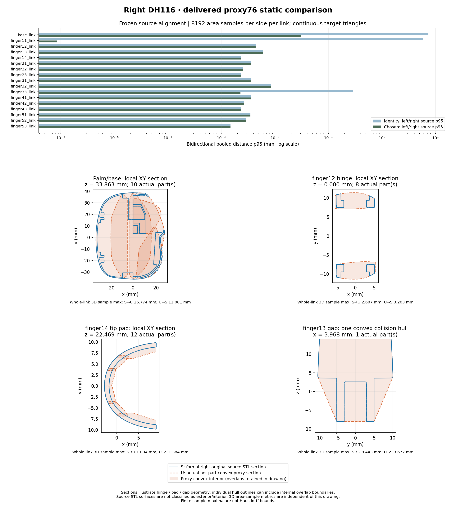

# D3：左手76块向右手的静态迁移候选

已完成一个迁移候选，没有重新分块：14个link原坐标复用，base／finger11／finger33三个link仅作局部变换。
**迁移及机械保护核验通过；几何质量仍有已证明的局部假相交，不宣称高精度PASS；本轮动力学0步。**

任务：[PR #4评论6258409147](https://github.com/LeoandDream/Nero_DH116_assets/pull/4#issuecomment-6258409147)。
开发基线 `a564d2841c20e6012d0ce605ea8f619ae9a219a5`；独立worktree／分支 `nero_dh116_right_proxy76`／`feature/d3-right-proxy76`。
正式右手MJCF SHA256仍为 `739d3d29bbfd4a6468fb8b75f4de09b719c0f96abb39508959c1dfc33a84b9cc`。
候选在 [`../../candidates/proxy76/model.xml`](../../candidates/proxy76/model.xml)，SHA256 `56949ed130a54b1d8b5fbd76e51b1262b45b7346e29130e42e8db156dd7d15d6`。

## 实际迁移

左手76个collision geom实际对应 **66 OBJ＋10 binary STL**，不是76个OBJ，也不是每个link都有细分。
17个link的实际映射、源SHA和geom属性见 `inventory.json` 与候选 `manifest.json`。
14个link共57块直接引用已有文件；19块烘焙局部变换：base10块Y镜像，finger11单块Y镜像并Z平移−3.25mm，
finger33的8块使用冻结小旋转／平移（旋转约0.229°；平移约[−0.018694,0.043338,0.396194]mm）。两个反射项均翻转三角面绕序。
未输出任何新分解；离线ConvexHull仅用于核对MuJoCo对每个已有mesh的实际凸化。

右手机械树、装配、惯性、关节轴／限位、线性Mimic、驱动、Keyframe、contact mask／参数／exclude保持原样。
旧coarse17碰撞geom被移除，未与新76叠加；右手17个原始STL视觉及源几何绑定不变。
编译后3286项受保护字段精确一致，手76＋臂51＋法兰8＝135块，其他原有碰撞保留。
所有171条候选资源引用均在本checkout内；19个变换文件全顶点／全三角面与冻结变换逐值一致。

## 逐link几何证据

源对齐：左右每侧8192个确定性面积样本，查询完整连续目标三角面；先测identity再测冻结变换，未依据AABB判等。
原始STL的17对SHA均不同。公开校验入口独立重算与冻结统计最大差3.47e−18m。

代理误差：每link每方向4096个面积样本，另查全部唯一源／代理边界顶点；测每块凸化后**并集暴露边界**，裁去内部重叠面。
S＝右手源三角面；U＝76块按link形成的凸并集边界。下表三元组均为 **p95／p99／观测max，单位mm**，不是Hausdorff上界。
源面位于proxy内部与遗漏源面分别记录；反向距离只用unsigned，不假定源STL是可靠闭实体。

| link | 块数 | 局部处理 | 左右源对齐p99(mm) | S→U p95/p99/max | U→S p95/p99/max |
| --- | ---: | --- | ---: | --- | --- |
| base_link | 10 | Y镜像 | 0.080010 | 14.783/21.869/26.774 | 3.456/8.027/11.001 |
| finger11_link | 1 | Y镜像；Z−3.25mm | 0.004661 | 4.501/5.834/7.352 | 3.943/5.666/6.980 |
| finger12_link | 8 | 原坐标复用 | 0.010566 | 1.976/2.280/2.607 | 2.253/2.647/3.203 |
| finger13_link | 1 | 原坐标复用 | 0.037964 | 5.505/7.812/8.443 | 2.210/3.014/3.672 |
| finger14_link | 12 | 原坐标复用 | 0.005681 | 0.998/1.000/1.004 | 1.158/1.338/1.384 |
| finger21_link | 1 | 原坐标复用 | 0.005273 | 2.936/3.405/3.799 | 3.865/5.394/6.196 |
| finger22_link | 1 | 原坐标复用 | 0.023662 | 4.341/5.864/6.876 | 2.233/2.681/3.057 |
| finger23_link | 12 | 原坐标复用 | 0.005052 | 1.022/1.237/1.325 | 1.196/1.566/1.707 |
| finger31_link | 1 | 原坐标复用 | 0.005518 | 2.884/3.431/3.795 | 3.826/5.382/6.241 |
| finger32_link | 1 | 原坐标复用 | 0.019055 | 5.007/5.907/6.571 | 2.243/2.762/2.998 |
| finger33_link | 8 | 小幅刚性对齐 | 0.004999 | 1.031/1.136/1.274 | 1.553/1.924/2.178 |
| finger41_link | 1 | 原坐标复用 | 0.005606 | 2.913/3.434/3.799 | 3.896/5.190/6.202 |
| finger42_link | 1 | 原坐标复用 | 0.021401 | 4.399/5.846/6.791 | 2.229/2.686/3.277 |
| finger43_link | 8 | 原坐标复用 | 0.004880 | 1.044/1.182/1.236 | 1.584/1.962/2.376 |
| finger51_link | 1 | 原坐标复用 | 0.005383 | 2.941/3.463/3.798 | 3.965/5.322/6.281 |
| finger52_link | 1 | 原坐标复用 | 0.032689 | 4.773/5.515/6.213 | 2.076/2.424/2.936 |
| finger53_link | 8 | 原坐标复用 | 0.004068 | 0.950/1.008/1.119 | 0.969/1.212/1.575 |

指腹分块仍保留约1–2mm量级的原有近似；finger12铰接凹槽保留部分间隙，但不能称为精确源面。
finger13／42等10个单凸件仍会封住凹槽。base的大S→U值包含掌内CAD源面埋入凸代理，
**不能把它解释为外壳整体坐标错位21.9mm**；哪些内部CAD面可达且需要参与碰撞尚为UNKNOWN。
`metrics/`提供每link双向完整数据、四个坐标分区、inside/outside分类及最大值坐标及最近三角面见证。



截面图只作定性解释，可能显示各分块的内部重叠边；三维定量指标已单独去除这些内部边界。

## 历史失败姿态与局部问题

只读取14个原有pre/post姿态，比较4组pair共56项，并以精确qpos、源SHA和FK重验15份原始源面证书。
本轮只有28次FK、8792次直接几何距离查询，step/reset/forward/接触求解均0；字段和积分状态前后不变。
来自旧两组exclude对照的姿态仅作为已保存qpos使用，**候选没有继承这些诊断exclude**。

229／451的base↔12、6498／6511的12↔42，以及6242／6395的13↔42／12↔43，均保留源面真实相交证据。
更细代理不改变原源几何及这些姿态的真实相交；原7000步全幅FAIL保持不变。

6451-post的13↔42源面间隙为 **+0.229434545mm**，新候选凸包仍严格交叠。
为排除MuJoCo距离查询的cutoff依赖，另以真实proxy顶点重建凸包半空间，解最大公共内切球LP并以long-double、60位Decimal及对偶证书复核：
原coarse17公共球半径0.088181802mm，新76为 **0.001338216mm（1.338µm）**。
这是凸实体内部交叠证书，**不是物理穿透深度或新动力学接触结果**；不同cutoff的MuJoCo负距离不能当作同一可靠深度。

在新候选公共球中心，连续查询到right源面的unsigned距离：13为1.364441mm，42为0.122898mm。
13的活跃凸包桥接面跨9.703229mm，原STL没有该共面三角面；42也有跨面cap。
因此已定位13↔42为局部代理修正对象，优先13；当前证据不能保证只改13就足够，是否还需改42为UNKNOWN。
复核数据／完整半空间／原面见证见 `gap_check/`。

## 结论与唯一下一步

- **可直接迁移：**表中14个identity link；这是坐标与现成资产复用结论，不是全部碰撞精度通过。
- **坐标修正已完成：**base、finger11、finger33；没有改变右手机械定义。
- **已证明局部不匹配：**13↔42仍有代理假交叠；base内腔及其余单凸段的完整可接触表面精度尚未验收，不据全表面误差重建整套。
- **唯一建议：**下一轮只检查／精化finger13在6451姿态暴露的跨槽cap，先冻结其余75块（包括finger42），重做同一静态间隙与源面覆盖核对；
  若仍不消除假交叠，再报告剩余证据，不自动扩大。真实源面相交另行保留，局部代理修正不能保证7000步全幅通过。
  本轮未执行局部再分块，未运行白碗、7000步、调参或任何新动力学；静态审查后再申请物理验收。

## 复核入口

复核需要仓库现有锁定环境（Python3.11.16、MuJoCo3.2.3、NumPy1.26.4；其余版本见 `environment.json`）。
本worktree未创建 `.reference-env`；本轮使用服务器已建立的同版本解释器，未安装依赖，实际路径见 `environment.json`，它不是脚本运行时依赖。
第三方需先按 [`examples/libero_reference/env/README.md`](../../../libero_reference/env/README.md) 建立checkout内环境，再执行以下命令；未建立环境时不能直接source激活脚本。
以下命令全为静态，输出必须是新路径：

```bash
source examples/libero_reference/env/activate.sh
mkdir -p runs
python tools/build_right_proxy76.py \
  --alignment examples/right_hand/candidates/proxy76/alignment.json --output runs/proxy76_rebuild
python examples/right_hand/proxy76_audit.py \
  --candidate examples/right_hand/candidates/proxy76/model.xml --output runs/new_audit.json
python examples/right_hand/proxy76_alignment.py --output runs/new_alignment.json
python examples/right_hand/proxy76_validate.py \
  --candidate examples/right_hand/candidates/proxy76/model.xml --output runs/new_metrics
python examples/right_hand/proxy76_contacts.py \
  --candidate examples/right_hand/candidates/proxy76/model.xml --output runs/new_contacts
python examples/right_hand/evidence/d3_proxy76/gap_check/check_convex_gap.py \
  --certificates examples/right_hand/evidence/d3_proxy76/existing-source-certificates.json --output runs/new_lp.json
python examples/right_hand/evidence/d3_proxy76/visual/plot_static.py --output runs/new_visual
python -m unittest discover -s tests -p test_right_proxy76.py -v
sha256sum -c examples/right_hand/evidence/d3_proxy76/SHA256SUMS
```

重建已实际核对：全部76个mesh几何SHA一致、19个烘焙文件字节一致，XML在资源引用解析为文件内容后完全一致。
471个原有tracked文件、左手V1、正式右手模型、main及原README工作树改动均保留；见 `verification.json`。
完整8192/侧原始对齐样本另保留于本次本地runs归档，可由已交付种子和公开STL逐值复算，未把冗余30MB样本重复提交。
