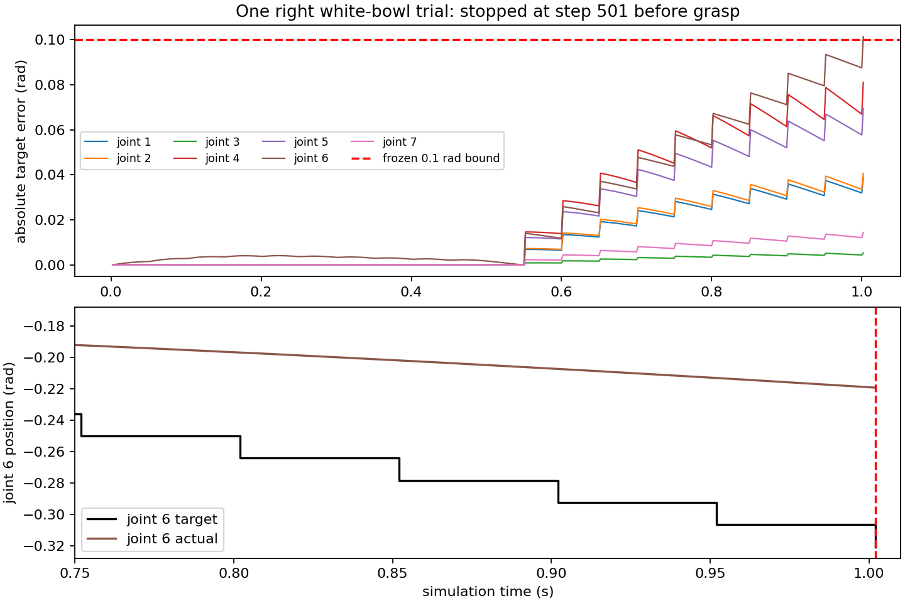

# D3：右手白碗唯一候选与一次首跑

**A：有限采样内部几何 PASS；B：FAIL；抓持 UNKNOWN。**
唯一首跑在接近阶段第 **501 步／1.002 s** 因机械臂关节6跟踪误差
**0.1013460045 rad > 冻结的0.1 rad** 停止，尚未闭合、抬升或持握。
本轮累计501个真实物理步、1次动力学尝试；真实退出码2。未重试、改动作或放宽判据。
原7000步全幅FAIL、左手V1、main和原工作树README均保留。

任务：[PR #4评论6257751387](https://github.com/LeoandDream/Nero_DH116_assets/pull/4#issuecomment-6257751387)。
基线 `8ffe0333c344669e3e3ad66125ba18f0cf48c0f6`，正式右手MJCF
SHA256 `739d3d29bbfd4a6468fb8b75f4de09b719c0f96abb39508959c1dfc33a84b9cc`。

## 候选与几何

只生成 `right_white_bowl_001` 一条候选：从右手源STL指腹三角面选点，结合原生白碗上沿壁尺寸，
单次有界求解拇指—食指对置夹持。主动闭合角度依次为
`[0.1271441360, 0.1612485091, 0.4299957164, 0, 0, 0] rad`。
三根闲置手指保持张开；NERO姿态与位置由右手夹持坐标推导，再生成接近、下降、闭合、100mm抬升和1.5s持握。
沿用230宏步的阶段时序，但**没有复制左手13D动作或闭合量**。历史沉降位置仅是明确的几何规划参考，未注入仿真。

`candidate.json` SHA256 `ba767b42f99d3562255909bde5c970d529ba254769029ec1cd7a98faf76af0fb`。
先冻结候选，再检查921个目标／四分点插值姿态，每姿态115组实际符合碰撞资格的手内pair，
共105915次：源STL严格穿越、边界不确定和凸代理重叠均为0。
最小返回凸代理正距离1.828513mm，**不是源三角面的最小间隙**。
生成与检查均为零动力学；完整记录为 `geometry.json.gz`，摘要为 `geometry-summary.json`。

限制：有限目标采样不证明样本间或实际跟踪路径连续安全，也未检查手外的机械臂／桌面／物体净空。
源STL非闭合时，面分离不能代替实体包含检查。指腹与碗半径是几何近似，不能证明一定形成接触。
IK首节点求解器未报收敛但位姿残差很小；最高节点姿态残差0.05737rad，关节6、7达到源限位。
这些限制均原样保留，没有重选候选。

## 实际首跑与验收

独立环境 `/data_robot/verification/nero_dh116_right`：Python3.11.16、MuJoCo3.2.3、
stock robosuite1.4.1、NumPy1.26.4、LIBERO `f78abd68ee283de9f9be3c8f7e2a9ad60246e95c`。
运行时用bubblewrap隐藏整个 `/data_robot/projects`；正式右手17块coarse代理、原始线性Mimic、
伺服与接触参数不变，仅保留原NERO base–link1 exclude。2716项命名物理字段精确一致。
119条场景资源引用均在独立checkout内；122项冻结输入SHA运行前后和复核时一致。
原生构造1次、seed20261007后底层native reset1次；step1非积分刷新2次、forward1007次，与501次真实mj_step分别计数。

首跑前新增并冻结的任务判据：相对**本次**沉降位置抬升至少20mm，在最后hold阶段连续至少1s无任何非手部支撑，
每步有正法向力的拇指及食指接触，碗中心XY径向向量内积为负。
沿用右手筛查界限：机械臂全步误差0.1rad、hold阶段主动关节误差0.02rad、Mimic0.02rad、
限位越界0.01rad、符合资格的机器人内外接触交叠2mm，任何数值警告／非有限状态即停。
这些不是厂家认证，也不把左手历史数值作为通过阈值。

| 项目 | 实际结果 |
| --- | --- |
| 计划／完成 | 230宏步、5750物理步／20完整宏步加下一宏步1步，共501步 |
| 首次失败 | step501，macro20，approach_high，ARM_TRACKING（关节6） |
| 机器人接触／手碗接触／数值警告 | 0／0／0；全程有限，限位越界0 |
| 最大Mimic残差 | 0.000000671328rad |
| 最大主动目标误差 | 0.026345rad（preshape瞬态；hold尚未执行，不能报告hold跟踪PASS） |
| Reset／本次沉降基准 | 0.9700000000m／step250、t=0.5s时0.8994107101m |
| 最终高度／相对Reset增量 | 0.8994109576m／−70.589042mm |
| 相对本次沉降增量／有效持握 | +0.000247509mm／0s，白碗仍由桌面支撑 |
| 原生完整任务／strict声明 | `native_task_result=false`／`strict_grasp_success_claim=false` |

`false`分别记录原生柜内放置任务结果和没有提出额外strict成功声明；不能把本次提前停止称为抓取动作已失败，
抓取及后续阶段保持UNKNOWN。接触和力来自RK4最后内部阶段缓存，状态与碗高度来自积分后的qpos。



直接触发：step500关节6误差0.0874741443rad；下一个50ms目标更新−0.0141198241rad，
实际只移动−0.0002479639rad，step501误差变为0.1013460045rad。
无碰撞和扭矩饱和证据；这不能唯一归因于控制器、惯量或模型缺陷。

**唯一下一步建议（本轮未实施）：**在新的授权试验中只把approach_high时间约伸长2倍，保留同一空间路径、手形、
其他阶段、模型、Reset、控制器和判据。本次关节6目标斜率0.282396rad/s，是左手参考同阶段0.139250rad/s的约2.028倍；
该比较不表示左手通过本轮标准。若减速后仍在无接触接近阶段越界，就不能认为该重定时足以解决先停；
若通过，也只证明消除了当前先停，仍须评价抓持和路径其余限制。

## 证据与入口

- `protocol-before-generation.json`、`freeze-before-geometry.json`、`frozen-before-first-step.json`：两次关口前的冻结记录。
- `model.xml`、`robot-physical-preflight.json`：实际组合场景及2716字段对照；保存的绝对资源路径是运行来源记录，不能作为可移植模型入口。
- `state.jsonl.gz`、`contacts.jsonl.gz`、`result.json`、`execution.json`：原始501步记录、结果与退出码。
- `postrun-review.json`、`runtime-review.json`：不调用模拟器的独立复算；`SHA256SUMS`绑定全部交付证据。

复用已有 `examples/libero_reference/env/bootstrap.sh` 的锁定环境。
右手入口为 `examples/right_hand/white_bowl_candidate.py`（一次离线生成）、`white_bowl_geometry.py`（离线内部检查）、
`white_bowl_model.py`（明确右手适配）、`white_bowl_run.py`（条件首跑）。
本次动作及验收文件可直接读取，无需旧实验目录；后续重新执行必须另行授权，不能把改动后轨迹当成本次首跑。

```bash
source examples/libero_reference/env/activate.sh
python examples/right_hand/white_bowl_geometry.py --self-check
# 只复查已冻结候选，不积分；输出需为新文件
mkdir -p runs
python examples/right_hand/white_bowl_geometry.py \
  --candidate examples/right_hand/evidence/d3_white_bowl_001/candidate.json \
  --output runs/new_geometry.json
# 以下会执行一次新动力学，不属于本轮已经消耗的尝试额度：
# python examples/right_hand/white_bowl_run.py --candidate CANDIDATE.json \
#   --geometry GEOMETRY.json --output runs/NEW_TRIAL
```

检查记录包括几何解析样例、实际body过滤及积分阻断自检、控制方法AST一致性、支撑与对向接触计量检查，
以及原始轨迹独立复算。没有运行会另行积分的全量测试，也没有合并main或把此结果升级为右手V1已验收。
